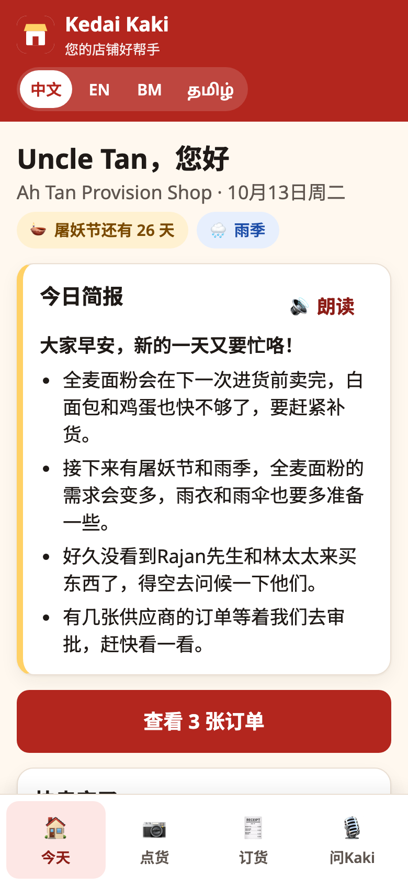
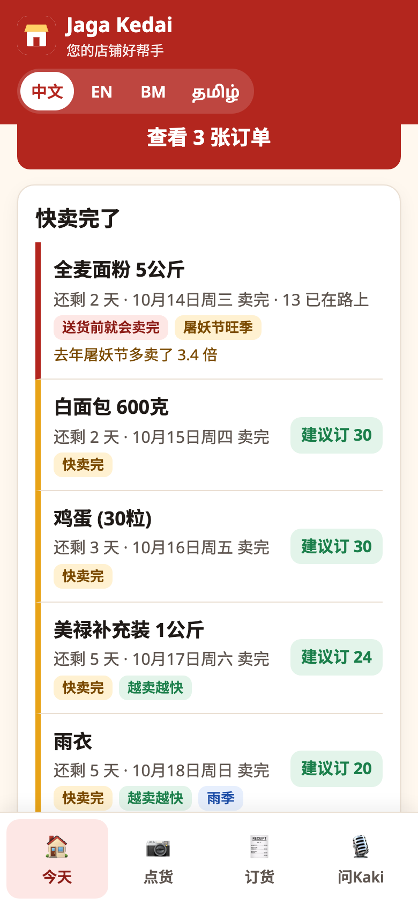
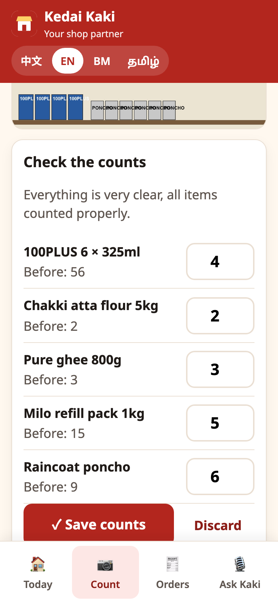
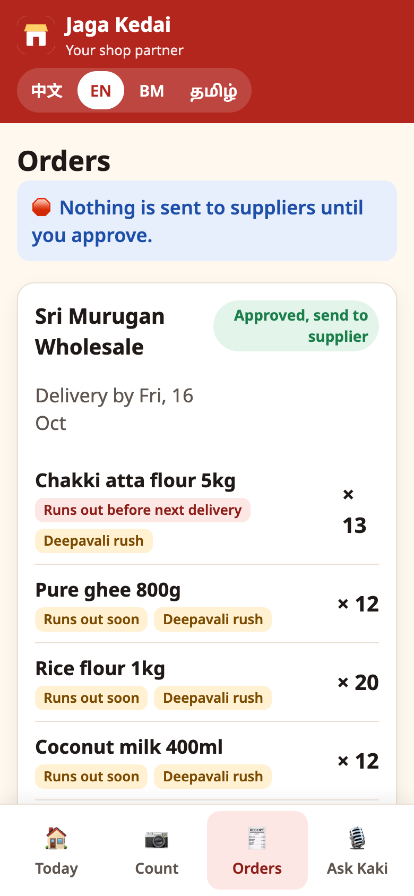
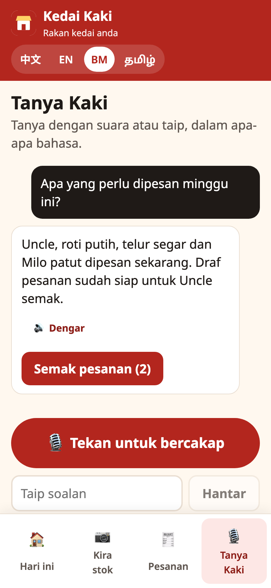
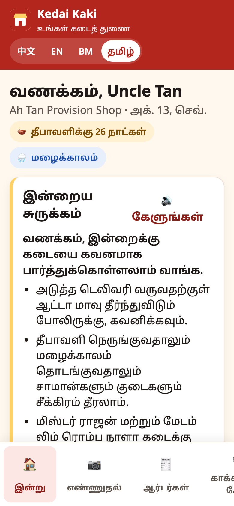
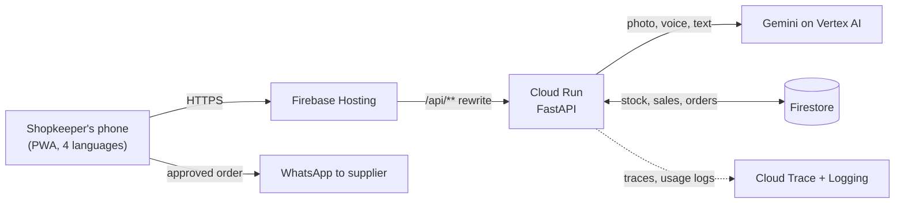

# Jaga Kedai 🏪 — an AI partner for heartland shopkeepers

> *Jaga* = to look after, *Kedai* = shop (Malay). Inside the app, your assistant is *Kaki*, the buddy (Singlish).

Singapore's neighbourhood provision shops run on memory and a notebook. Supermarkets
have data teams; Uncle Tan, 64, has a 30-year feel for his shop in Toa Payoh — and
more comfort in Mandarin than in spreadsheets. When the monsoon or Deepavali shifts
demand, he finds out when the shelf is already empty.

**Jaga Kedai** lets him run the shop with a phone, in his own language:

- 📷 **Snap a shelf, Kaki counts it.** Gemini reads the photo and proposes stock counts; he checks and saves.
- 🎙 **Ask by voice, in 中文, English, Bahasa Melayu or தமிழ்.** "这个星期要订什么货？" — Kaki answers from the shop's own sales and stock, out loud.
- 🧾 **Orders drafted per supplier, never sent without him.** Quantities come from the forecast, not the language model. He edits, approves, and sends with one tap on WhatsApp.
- 🪔 **Remembers last Deepavali.** The forecast learns each festival item's uplift from last year's sales ("ghee sold 3.2× more in the final week") and orders ahead of the rush.
- 🌧 **Ready for the monsoon** — rising umbrella and poncho sales are caught early.
- 💛 **Notices the regulars.** "Mdm Lim hasn't come in for 19 days" — a nudge to check on a neighbour.

### Hard stops, by design
AI proposes; the shopkeeper decides. Shelf counts don't change stock until he saves them,
orders stay drafts until he approves them, and nothing reaches a supplier until he taps
*Send*. Gemini never sets a quantity: every number traces back to sales history.

| | |
|---|---|
|  |  |
|  |  |
|  |  |

## How it uses Google Cloud

| Technology | Role |
|---|---|
| **Gemini** (Vertex AI) | Shelf-photo counting (vision), voice questions answered directly from audio, the daily briefing, and speech replies (Gemini TTS) — in four languages. Structured JSON outputs only. |
| **Cloud Run** | The FastAPI service: forecasting, order planning, the Gemini calls, and the business rules (hard stops, rate limits). |
| **Firestore** | The shop's live data: products and stock, suppliers, daily sales, regulars, shelf scans, orders and the activity timeline. Browsers can't touch it; only the API's service account can. |
| **Firebase Hosting** | Serves the mobile web app (installable PWA) and routes `/api/**` to Cloud Run on the same origin. |
| **Cloud Trace + Cloud Logging** | A trace per AI action, and one structured log line per Gemini call with tokens and estimated cost, by feature, shop and visitor ([docs/usage.md](docs/usage.md)). |



## Run locally

```bash
# API (http://localhost:8080) — in-memory store, seeded demo shop
cd api && cp .env.example .env    # add GEMINI_API_KEY, or GOOGLE_CLOUD_PROJECT for Vertex AI
uv sync && uv run uvicorn kedai.main:app --port 8080

# Web (http://localhost:5173)
cd web && npm install && npm run dev
```

Without a Gemini key the app still runs: briefings fall back to templates and the
shelf scan offers manual counting.

## Deploy

Needs the [gcloud CLI](https://cloud.google.com/sdk/docs/install) and the
[Firebase CLI](https://firebase.google.com/docs/cli) (`npm i -g firebase-tools`), both logged in.

```bash
PROJECT_ID=<your-project> deploy/deploy.sh
```

It enables the APIs, creates Firestore (Singapore region), a least-privilege service
account, deploys the API to Cloud Run (kept warm), builds the web app and deploys
Firebase Hosting plus Firestore rules. The demo shop seeds itself on first request and
refreshes once a day, so every visitor sees a current, consistent story.

## Tests

```bash
cd api && uv run pytest     # forecasting, festival learning, hard stops, fallbacks
cd web && npm test          # language switching, approval flow
```

## Demo data

*Ah Tan Provision Shop* is fictional: 32 everyday products from four distributors, with
sales generated from weekday traffic, paydays, monsoon rain and the run-up to Deepavali
(8 Nov 2026). Malay and Tamil text should be reviewed by native speakers before real use.
